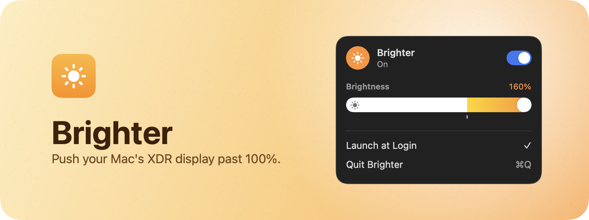

<div align="center">
  
<hr>

## Install

```sh
curl -fsSL https://raw.githubusercontent.com/ridafkih/brighter/main/install.sh | sh
```

Downloads the latest release into `/Applications` and opens it. Requires macOS 15 or later and a Liquid Retina XDR or Pro Display XDR.

## Usage

Click the sun in the menu bar and flip Brighter on. The brightness slider then runs past 100%, up to 160%. Grant Accessibility access and the brightness keys go past 100% too.

## Contribute

Pull requests and issues are welcome. Building needs Xcode and [XcodeGen](https://github.com/yonaskolb/XcodeGen) (`brew install xcodegen`).

```sh
git clone https://github.com/ridafkih/brighter.git
cd brighter
make run
```

`make test` runs the tests and `make install` builds a release copy into `/Applications`. Every push to `main` is built, signed, notarized and published as a release by CI.
